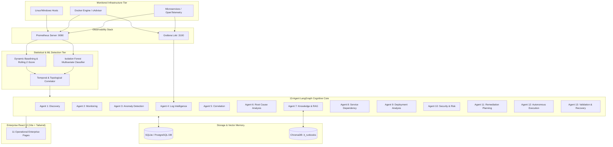

# NEXUS AI: Autonomous IT Operations & Incident Resolution Platform

[](https://github.com/Darshi7587/Autonomous_Incident_Resolution)
[](https://python.org)
[](https://fastapi.tiangolo.com)
[](https://langchain-ai.github.io/langgraph/)
[-61DAFB.svg?logo=react)](https://react.dev)
[](https://trychroma.com)
[](https://prometheus.io)
[](https://grafana.com/oss/loki/)

> **NEXUS AI** is an enterprise-grade Autonomous IT Operations (AIOps) and Incident Management Platform. It transforms IT infrastructure management from reactive human firefighting into continuous, closed-loop autonomous observation, multi-modal anomaly discovery, multi-agent investigation, evidence-grounded root cause analysis (RCA), risk-evaluated remediation, and independent recovery verification.

---

## 1. Key Architectural Capabilities

- **Zero Rule-Based Heuristics**: Dynamic statistical baselining (Interquartile Range $IQR = Q_3 - Q_1$, Median Absolute Deviation $MAD$, Exponential Moving Averages) and Scikit-Learn Isolation Forest multivariate anomaly detection.
- **Real Multi-Modal Telemetry Ingestion**:
  - **Prometheus PromQL Engine**: Continuous scraping of host metrics (`node_exporter`), container metrics (`cAdvisor`), and application metrics (`http_requests_total`, `http_request_duration_seconds_bucket`).
  - **Grafana Loki LogQL Streams**: Regex pattern matching for stack traces, exception bursts, and error correlations.
  - **Docker Engine API**: Live container discovery, resource streams, restart tracking, and lifecycle controls.
  - **OpenTelemetry & Blackbox Exporter**: Distributed trace spans and synthetic HTTP/TCP probes.
- **13-Agent LangGraph Cognitive Architecture**: Coordinated state machine with typed state schemas, tool allowlists, and human-in-the-loop approval gates.
- **RAG Knowledge Base (ChromaDB)**: Dense semantic vector search over `it_runbooks` and self-improving historical incident resolutions.
- **Enterprise React Cockpit**: Modern dark theme (Vite + Tailwind CSS + Lucide React + React Flow + Recharts), live bidirectional WebSocket feeds (`ws://localhost:8000/ws/events`), and 11 operational pages.
- **Strict Safety Governance**: Fine-grained risk scoring (LOW, MEDIUM, HIGH, CRITICAL), parameterized tool allowlists, execution timeouts, and automated rollbacks upon failed verification.

---

## 2. High-Level System Architecture



---

## 3. The 13 Specialized AI Agents

| Agent # | Agent Name | Core Responsibility | Integrated Tools / Data Source |
|---|---|---|---|
| **Agent 1** | **Discovery Agent** | Discovers hosts, containers, and active services; registers infrastructure inventory. | Docker API, Network Scanner |
| **Agent 2** | **Monitoring Agent** | Executes continuous PromQL polling and tracks real-time metric streams. | Prometheus API, Blackbox Exporter |
| **Agent 3** | **Anomaly Detection Agent** | Evaluates streaming telemetry against dynamic baselines and Isolation Forest models. | Dynamic Baseline Model, Scikit-Learn |
| **Agent 4** | **Log Intelligence Agent** | Queries Loki for error streams, identifies stack traces, and detects log pattern bursts. | Loki LogQL Engine |
| **Agent 5** | **Incident Correlation Agent** | Deduplicates alerts, clusters multi-service symptoms, and synthesizes unified incidents. | Graph Traversal, Temporal Clustering |
| **Agent 6** | **Root Cause Analysis Agent** | Formulates strictly factual, evidence-backed RCA reports without LLM hallucinations. | Multi-modal Evidence Synthesizer |
| **Agent 7** | **Knowledge & RAG Agent** | Performs dense semantic search over `it_runbooks` and historical incident resolutions in ChromaDB. | ChromaDB, Sentence Transformers |
| **Agent 8** | **Service Dependency Agent** | Dynamically constructs and navigates the directed service dependency graph and blast radius. | Service Topology Engine |
| **Agent 9** | **Deployment Analysis Agent** | Audits recent container deployments, restarts, configuration diffs, and image mutations. | Docker Events API, Git Inspector |
| **Agent 10** | **Security & Risk Assessment Agent** | Evaluates blast radius, data loss risk, and enforces human approval requirements. | Policy Validator, Safety Matrix |
| **Agent 11** | **Remediation Planning Agent** | Formulates step-by-step resolution plans with preconditions, rollbacks, and verification checks. | RAG Knowledge Base, Action Planner |
| **Agent 12** | **Autonomous Execution Agent** | Executes approved remediation actions via sandboxed, authorized infrastructure connectors. | Docker Execution Connector (Allowlisted) |
| **Agent 13** | **Validation & Recovery Agent** | Collects post-remediation metrics and logs; verifies baseline recovery and triggers rollback if failed. | Prometheus API, Health Prober, Rollback |

---

## 4. Incident Lifecycle State Machine

```
NEW ➔ INVESTIGATING ➔ RCA_COMPLETED ➔ AWAITING_APPROVAL ➔ REMEDIATING ➔ VERIFYING ➔ RESOLVED
                                              │                                      │
                                              ▼                                      ▼
                                          ESCALATED                             ROLLED_BACK
```

---

## 5. Enterprise React Frontend (11 Pages)

1. **Command Center**: Executive KPI tiles, cluster CPU/Memory sparklines, P95 latency charts, active incident ticker, and chaos injection simulator.
2. **Live Infrastructure**: Connected host inventory and Docker containers grid with CPU/Memory progress bars and container restart controls.
3. **Incident Management**: Multi-facet filterable incident table with search, severity badges, and one-click drilldown.
4. **Incident Intelligence**: Deep-dive console: incident overview, timeline, concrete supporting evidence cards, verified logs, RCA hypothesis, and remediation preview.
5. **AI Agent Control Center**: Interactive React Flow canvas depicting all 13 agents with pulsing states, tasks, and execution duration stats.
6. **Service Dependency Map**: Drag-and-drop interactive topological graph with incident heatmaps and affected node highlights.
7. **Autonomous Remediation**: Structured plan review, risk level breakdown, Approve / Reject controls, and live execution terminal.
8. **Knowledge Intelligence**: ChromaDB `it_runbooks` browser and semantic vector similarity search tester.
9. **AIOps Analytics**: MTTD, MTTR, weekly incident frequency charts, and resolution success rates.
10. **Audit Trail**: Searchable chronological log of all agent tool calls, approval decisions, and infrastructure commands.
11. **Integrations Console**: Connection test bench for Prometheus, Loki, Docker, and OpenTelemetry.

---

## 6. Getting Started

### Prerequisites

- Python 3.10+ (tested on Python 3.11, 3.12, 3.13)
- Node.js 18+ and npm
- Docker Desktop (optional, for Prometheus/Loki/cAdvisor monitoring stack)

### 1. Backend Setup

```bash
# Clone the repository
git clone https://github.com/Darshi7587/Autonomous_Incident_Resolution.git
cd Autonomous_Incident_Resolution

# Install backend dependencies
pip install -r requirements.txt

# Launch FastAPI Server
python -m uvicorn backend.main:app --host 0.0.0.0 --port 8000 --reload
```
- API Docs: `http://localhost:8000/docs`
- Health Endpoint: `http://localhost:8000/health`
- WebSocket Stream: `ws://localhost:8000/ws/events`

### 2. Frontend Setup

```bash
cd frontend
npm install
npm run dev
```
- Dashboard: `http://localhost:3000`

### 3. Full Observability Stack (Prometheus, Loki, Node Exporter, cAdvisor)

```bash
docker-compose -f infrastructure/docker-compose.monitoring.yml up -d
```
- Prometheus: `http://localhost:9090`
- Loki: `http://localhost:3100`
- Node Exporter: `http://localhost:9100`

---

## 7. Running Tests

```bash
python tests/run_tests.py
```
Validates:
1. Database schema creation & seeding
2. ChromaDB RAG semantic vector similarity search
3. Statistical dynamic baselining (IQR / Modified Z-Score)
4. Scikit-Learn Isolation Forest multivariate anomaly detection

---

## 8. License

Licensed under the Apache 2.0 License.
