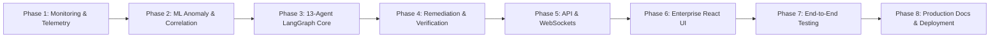

# NEXUS AI: Implementation Roadmap & Milestones

---

## Overview

This roadmap defines the engineering phases for constructing **NEXUS AI**. Each phase delivers functional, tested, and validated components. No phase relies on mocked or dummy shortcuts.

---

## Phase Breakdown

---

### Phase 1: Real Monitoring & Infrastructure Integration
- **Deliverables**:
  - `infrastructure/docker-compose.monitoring.yml`: Prometheus, Grafana Loki, Promtail, Node Exporter, cAdvisor, and Blackbox Exporter configuration.
  - `backend/integrations/prometheus/client.py`: Asynchronous PromQL query client supporting instant queries, range queries, targets status, and health metrics.
  - `backend/integrations/loki/client.py`: Asynchronous LogQL client supporting regex filtering, label queries, and timestamp windows.
  - `backend/integrations/docker/client.py`: Asynchronous Docker Engine API client for container discovery, resource metrics, logs, and container actions.
  - `backend/integrations/opentelemetry/client.py`: OpenTelemetry collector client for trace and span correlation.
- **Verification**:
  - Connectivity tests to Prometheus, Loki, and Docker.
  - Accurate query results for CPU, memory, container lists, and error logs.

---

### Phase 2: Statistical & Machine Learning Anomaly Detection Engine
- **Deliverables**:
  - `backend/detection/dynamic_baseline.py`: Rolling mean, standard deviation, IQR, and adaptive threshold boundary calculation.
  - `backend/detection/isolation_forest.py`: Scikit-Learn Isolation Forest pipeline for multivariate telemetry vectors.
  - `backend/correlation/correlator.py`: Temporal sliding-window aggregator and topological alert clustering (grouping related alerts across services).
  - `backend/database/models.py`: SQLAlchemy database models (Incidents, Alerts, Events, InfrastructureNodes, ServiceDependencies, AuditLogs).
- **Verification**:
  - Unit tests verifying anomaly scoring against synthetic baseline shifts and multi-metric vectors.
  - Correlator tests validating multi-alert deduplication into unified incidents.

---

### Phase 3: 13-Agent LangGraph Cognitive Architecture & ChromaDB RAG
- **Deliverables**:
  - `backend/knowledge/chroma_store.py`: ChromaDB integration with `sentence-transformers/all-MiniLM-L6-v2`, loading default `it_runbooks` and historical incident knowledge.
  - `backend/agents/`:
    - `discovery_agent.py` (Agent 1)
    - `monitoring_agent.py` (Agent 2)
    - `anomaly_detection_agent.py` (Agent 3)
    - `log_intelligence_agent.py` (Agent 4)
    - `correlation_agent.py` (Agent 5)
    - `rca_agent.py` (Agent 6: Evidence-backed RCA synthesis)
    - `knowledge_rag_agent.py` (Agent 7: Runbook search)
    - `service_dependency_agent.py` (Agent 8: Graph analysis)
    - `deployment_agent.py` (Agent 9: Container & config changes)
    - `security_risk_agent.py` (Agent 10: Blast radius & risk scoring)
    - `remediation_planner_agent.py` (Agent 11: Action plans)
    - `autonomous_execution_agent.py` (Agent 12: Controlled actions)
    - `validation_recovery_agent.py` (Agent 13: Independent verification & rollback)
  - `backend/workflows/orchestrator.py`: LangGraph StateGraph connecting all 13 nodes with conditional routing.
- **Verification**:
  - Multi-agent state transition tests from Discovery -> Anomaly -> RCA -> Planning.
  - ChromaDB semantic retrieval verification for IT operational runbooks.

---

### Phase 4: Autonomous Remediation, Risk Governance & Rollback
- **Deliverables**:
  - `backend/remediation/executor.py`: Safe execution engine with strict action allowlist (Docker restart, service reload, scale, memory cache clear).
  - `backend/remediation/safety_gate.py`: Risk assessment policy evaluator (automatic approval for LOW risk, human approval requirement for MEDIUM/HIGH/CRITICAL).
  - `backend/validation/recovery_verifier.py`: Post-remediation metric collection, baseline comparison, and rollback trigger.
  - `backend/core/audit.py`: Immutable audit logging of all agent actions, parameters, and results.
- **Verification**:
  - Execution sandbox tests verifying rejection of unauthorized commands.
  - Rollback scenario verification upon simulated remediation failure.

---

### Phase 5: FastAPI REST API & Real-Time WebSocket Gateway
- **Deliverables**:
  - `backend/main.py`: FastAPI application entrypoint with CORS, error handling, and health endpoints.
  - `backend/api/routers/`:
    - `overview.py`: Command Center summary statistics.
    - `infrastructure.py`: Connected hosts, containers, and services.
    - `incidents.py`: Incident CRUD, timeline, logs, metrics, and RCA.
    - `agents.py`: Agent status, execution history, and live state.
    - `topology.py`: Service dependency graph endpoints.
    - `remediation.py`: Action plans, approval/rejection endpoints, execution logs.
    - `knowledge.py`: Runbook search, listing, and management.
    - `analytics.py`: MTTD, MTTR, incident distributions, and performance metrics.
    - `audit.py`: Audit log retrieval and filtering.
    - `integrations.py`: Monitoring endpoints config and health check.
  - `backend/api/websocket_hub.py`: WebSocket connection manager broadcasting live incident, telemetry, and agent state events.
- **Verification**:
  - Automated API test suite covering all REST endpoints and WebSocket broadcasts.

---

### Phase 6: Enterprise React Frontend (React + Vite + Tailwind CSS)
- **Deliverables**:
  - Clean JavaScript (ES6+, JSX) Vite project configured with Tailwind CSS, Lucide React, React Flow, Recharts, and Axios.
  - 11 Dedicated Enterprise Pages:
    1. `CommandCenter.jsx`: Executive overview, cluster health, active incidents, metric sparklines.
    2. `LiveInfrastructure.jsx`: Host and container grid, resource bars, Docker status.
    3. `IncidentManagement.jsx`: Incident table with search, severity filters, status tags.
    4. `IncidentIntelligence.jsx`: Incident deep dive (evidence cards, logs, metrics, RCA, timeline).
    5. `AgentControlCenter.jsx`: 13-agent React Flow live orchestration canvas with status pulses.
    6. `ServiceDependencyMap.jsx`: Interactive topological graph with upstream/downstream highlights.
    7. `AutonomousRemediation.jsx`: Approval console, risk breakdown, action terminal.
    8. `KnowledgeIntelligence.jsx`: Runbook browser and semantic vector query interface.
    9. `AnalyticsDashboard.jsx`: MTTD, MTTR, incident trends, resolution success rates.
    10. `AuditTrail.jsx`: Full immutable audit log table with filter and inspection modals.
    11. `IntegrationsConfig.jsx`: Connection test bench for Prometheus, Loki, Docker, OpenTelemetry.
- **Verification**:
  - UI functional verification: live WebSocket data updates, interactive React Flow maps, real button actions.

---

### Phase 7: End-to-End System Testing & Infrastructure Scenarios
- **Deliverables**:
  - Automated integration test suite (`tests/`):
    - Test Prometheus query pipelines and live metric ingestion.
    - Test statistical anomaly detection on real and synthetic series.
    - Test 13-agent workflow execution and evidence-backed RCA formulation.
    - Test human-in-the-loop approval gate and Docker container remediation.
    - Test post-remediation verification and rollback execution.
- **Verification**:
  - Full end-to-end integration test execution with all assertions passing.

---

### Phase 8: Comprehensive Documentation & Repository Maintenance
- **Deliverables**:
  - Production `README.md` with architecture diagrams, setup commands, Docker instructions, API reference, and screenshots.
  - Setup and deployment scripts.
  - Clean GitHub commit history pushed to remote.
