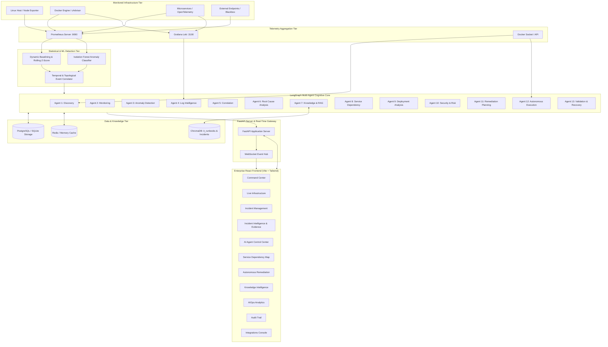
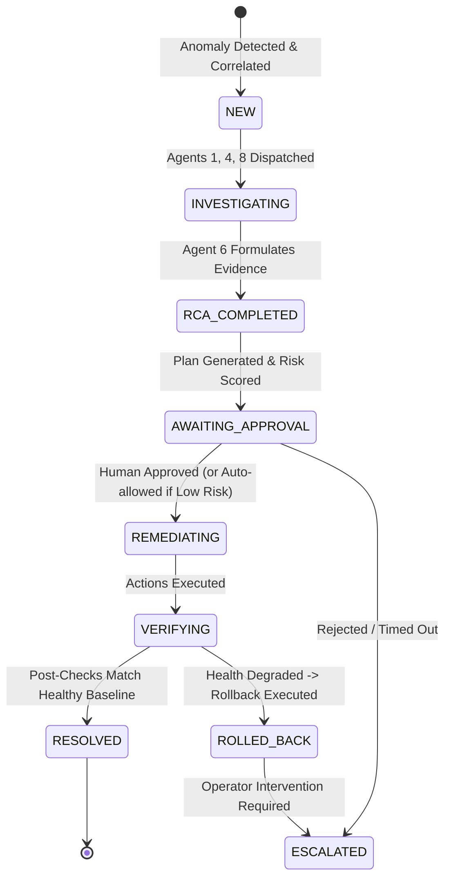

# NEXUS AI: Autonomous IT Operations & Incident Resolution Platform
## System Architecture & Technical Specification

---

## 1. Executive Summary & Vision

**NEXUS AI** is an enterprise-grade Autonomous IT Operations (AIOps) and Incident Management Platform engineered to transition infrastructure management from reactive human firefighting to continuous, closed-loop autonomous observation, investigation, remediation, and verification.

Unlike conventional monitoring tools that rely on static thresholds or rule-based heuristics, NEXUS AI employs:
1. **Statistical & Machine Learning Anomaly Detection**: Continuous dynamic baselining, rolling distribution analysis (IQR/Z-Score), and Isolation Forest multivariate anomaly detection.
2. **Real Multi-Modal Telemetry Ingestion**: Native HTTP integrations with Prometheus (metrics via PromQL), Grafana Loki (log streams and LogQL pattern matching), Docker Engine API (container lifecycle and stats), and OpenTelemetry (distributed traces).
3. **13-Agent LangGraph Cognitive Architecture**: Coordinated multi-agent workflow where specialized agents handle infrastructure discovery, live monitoring, statistical anomaly detection, log intelligence, cross-service incident correlation, evidence-based root cause analysis (RCA), RAG runbook retrieval via ChromaDB, service dependency mapping, deployment impact analysis, operational risk scoring, autonomous remediation execution, and post-action recovery verification.
4. **Safety-Guarded Autonomous Execution**: Fine-grained Risk Assessment, pre-execution human approval gates, strict tool allowlists, rollback procedures, and immutable audit trails.
5. **Real-Time Enterprise Cockpit**: High-density React.js (Vite + Tailwind CSS + Lucide + React Flow + Recharts) operational console connected via live WebSockets.

---

## 2. High-Level Architecture

---

## 3. Real Infrastructure Monitoring Tier

NEXUS AI establishes genuine bidirectional integrations with industry-standard observability stacks:

### 3.1 Prometheus (PromQL Engine)
- **Target Connection**: Direct HTTP REST API (`/api/v1/query`, `/api/v1/query_range`, `/api/v1/targets`).
- **Telemetry Gathered**:
  - Host Level: `node_cpu_seconds_total`, `node_memory_MemAvailable_bytes`, `node_filesystem_free_bytes`, `node_network_receive_bytes_total`, `node_load1`.
  - Container Level: `container_cpu_usage_seconds_total`, `container_memory_working_set_bytes`, `container_network_transmit_errors_total`.
  - Application Level: `http_requests_total`, `http_request_duration_seconds_bucket`, `database_connection_errors_total`.
- **Query Execution Engine**: Asynchronous PromQL client with automated metric formatting, rate calculation, and multi-window aggregations.

### 3.2 Grafana Loki (Log Ingestion & LogQL)
- **Target Connection**: HTTP REST API (`/loki/api/v1/query_range`, `/loki/api/v1/labels`).
- **Search Capabilities**: Querying by timestamp range, container name, service label, log level, and error regex patterns.
- **Log Stream Extraction**: Parses structured and unstructured container and application logs to identify stack traces, exception types, and log volume spikes.

### 3.3 Docker Engine Client
- **Target Connection**: Docker Daemon (`/var/run/docker.sock` on Linux or `npipe:////./pipe/docker_engine` on Windows).
- **Capabilities**:
  - Live discovery of all active, paused, and stopped containers.
  - Streaming container resource stats (CPU percentage, memory usage, limits, network I/O).
  - Controlled lifecycle execution (inspect, restart, stop, pause, unpause, scale, fetch container logs).

### 3.4 OpenTelemetry & Blackbox Exporter
- **Distributed Traces**: Trace context propagation, span latency analysis, and service-to-service call mapping.
- **Synthetics & Probing**: HTTP 2xx/3xx health checks, SSL certificate validity, DNS lookup latency, TCP port connectivity.

---

## 4. Machine Learning & Statistical Anomaly Detection

**Strict Requirement**: No hardcoded static `if metric > 80` rules.

The Detection Engine applies advanced statistical and unsupervised ML methodologies:

1. **Dynamic Baseline Estimation**:
   - Calculates rolling time-window mean ($\mu_t$) and standard deviation ($\sigma_t$).
   - Computes rolling Median and Interquartile Range ($IQR = Q_3 - Q_1$) to remain resilient against metric outliers.
   - Computes dynamic boundary envelopes:
     $$\text{Upper Limit} = Q_3 + k \times IQR$$
     $$\text{Lower Limit} = Q_1 - k \times IQR$$
     where $k$ dynamically adapts to historical volatility.

2. **Isolation Forest Multivariate Classification**:
   - Trains on multi-metric vectors: $[\text{cpu\_util}, \text{mem\_util}, \text{req\_rate}, \text{err\_rate}, \text{latency}]$.
   - Computes anomaly score $s(x, n) = 2^{-\frac{E(h(x))}{c(n)}}$.
   - Detects compound anomalies (e.g., normal CPU + normal memory, but anomalous latency-to-error-rate ratio).

3. **Temporal & Topological Alert Correlation**:
   - Aggregates multi-source anomalies occurring within sliding temporal windows ($T_{\text{window}}$).
   - Traverses the Service Dependency Graph to identify upstream originators and downstream cascade symptoms.
   - Collapses multiple alerts into a single unified `Incident`.

---

## 5. 13-Agent LangGraph Cognitive Architecture

Each agent is an autonomous LangGraph node equipped with specialized tools, typed state schemas, and structured outputs:

| Agent # | Agent Name | Primary Responsibility | Integrated Tools / Data Source |
|---|---|---|---|
| **Agent 1** | **Discovery Agent** | Discovers host nodes, Docker containers, and active services; registers infrastructure inventory. | Docker API, Network Scanner, Service Registry |
| **Agent 2** | **Monitoring Agent** | Executes continuous PromQL polling and tracks real-time metric streams. | Prometheus API, Blackbox Exporter |
| **Agent 3** | **Anomaly Detection Agent** | Evaluates metric time-series against dynamic baselines and Isolation Forest models. | Dynamic Baseline Model, Scikit-Learn IsolationForest |
| **Agent 4** | **Log Intelligence Agent** | Queries Loki for error streams, identifies stack traces, and detects log pattern bursts. | Loki LogQL Engine, Pattern Parser |
| **Agent 5** | **Incident Correlation Agent** | Deduplicates alerts, identifies root topological clusters, and initiates unified incidents. | Graph Traversal, Temporal Clustering |
| **Agent 6** | **Root Cause Analysis (RCA) Agent** | Synthesizes metric anomalies, log traces, and dependency hops to construct evidence-backed RCA. | Multi-modal Evidence Synthesizer |
| **Agent 7** | **Knowledge & RAG Agent** | Performs dense semantic search over `it_runbooks` and historical incident resolutions in ChromaDB. | ChromaDB, Sentence Transformers (`all-MiniLM-L6-v2`) |
| **Agent 8** | **Service Dependency Agent** | Dynamically constructs and updates the directed service dependency graph and blast radius. | Service Topology Engine, Network Telemetry |
| **Agent 9** | **Deployment Analysis Agent** | Inspects recent container updates, Git commits, config mutations, and environment diffs. | Docker Events API, Deployment Registry |
| **Agent 10** | **Security & Risk Assessment Agent** | Evaluates operational blast radius, data loss risk, and assigns safety level (LOW, MEDIUM, HIGH, CRITICAL). | Policy Validator, Safety Matrix |
| **Agent 11** | **Remediation Planning Agent** | Formulates step-by-step remediation plans with explicit preconditions, rollbacks, and verification checks. | RAG Knowledge Base, Action Planner |
| **Agent 12** | **Autonomous Execution Agent** | Executes approved remediation actions via sandboxed, authorized infrastructure connectors. | Docker Execution Connector, System Action Runner |
| **Agent 13** | **Validation & Recovery Agent** | Collects post-remediation metrics and logs; verifies health against pre-incident baselines. | Prometheus API, Health Prober, Rollback Trigger |

---

## 6. Incident Lifecycle State Machine

---

## 7. Storage & Knowledge Tier

1. **Relational Database (SQLAlchemy with SQLite / PostgreSQL)**:
   - `users`: Identity, hashed passwords, roles (`admin`, `operator`, `auditor`).
   - `infrastructure_nodes`: Hosts, containers, services, connectivity status, IP/ports.
   - `service_dependencies`: Directed edges representing upstream/downstream dependencies.
   - `incidents`: Unique ID, title, severity, status, affected resources, timestamps.
   - `incident_events`: Immutable chronological event stream for each incident.
   - `rca_reports`: Evidence items, hypotheses, affected services, confidence score.
   - `remediation_plans`: Plan steps, commands, risks, preconditions, rollback steps.
   - `approval_requests`: Status (`pending`, `approved`, `rejected`), user ID, comments.
   - `execution_records`: Executed commands, exit codes, output logs, execution durations.
   - `audit_logs`: Detailed tamper-evident event log of all system and user operations.
   - `integrations`: Configured endpoints (Prometheus, Loki, Docker, OpenTelemetry).

2. **ChromaDB Vector Store**:
   - Collection: `it_runbooks`
   - Embedding Model: `sentence-transformers/all-MiniLM-L6-v2`
   - Metadata: `service_type`, `incident_category`, `severity`, `risk_level`, `version`.
   - Embeddings for SOPs, official recovery runbooks, past incident RCAs, and known solutions.

---

## 8. Enterprise Frontend Architecture (React + Vite)

Strict adherence to modern React JavaScript standards (ES6+, JSX, Tailwind CSS):
- **Command Center**: Real-time KPI tiles, active incident feeds, cluster CPU/Memory sparklines, latency trends, and active agent activity tickers.
- **Live Infrastructure**: Grid and table views of Docker containers and host systems with live status badges, CPU/RAM bars, and container restart counters.
- **Incident Management**: Multi-facet filterable incident table with sorting, search, severity badges, and one-click drilldown.
- **Incident Intelligence**: Split-screen comprehensive view: timeline, metric charts, log stream viewer, evidence cards, dependency blast radius, and RCA report.
- **AI Agent Control Center**: Interactive React Flow canvas depicting all 13 agents, live pulsing execution states, logs, and token/duration stats.
- **Service Dependency Map**: Drag-and-drop interactive topological graph with incident heatmaps and affected node highlights.
- **Autonomous Remediation**: Structured plan review, step-by-step risk breakdown, Approve / Reject controls, and live execution terminal.
- **Knowledge Intelligence**: Runbook browser, vector similarity search tester, and runbook editor.
- **Analytics**: MTTD / MTTR charts, incident frequency heatmaps, remediation success rates.
- **Audit Trail**: Searchable chronological log of all agent tool calls, approval decisions, and infrastructure commands.
- **Integrations Console**: Endpoint configuration test bench for Prometheus, Loki, Docker, and OpenTelemetry.

---

## 9. Security & Governance

1. **Authentication & Authorization**:
   - Stateless JWT tokens (Access + Refresh tokens).
   - Role-Based Access Control (RBAC): `ADMIN` (configure integrations, approve critical actions), `OPERATOR` (acknowledge incidents, approve medium actions), `VIEWER` (read-only audit access).
2. **Execution Allowlist & Sandboxing**:
   - Zero arbitrary shell execution by LLMs.
   - Parametric command validation against an immutable white list of actions (e.g., `docker_restart`, `docker_scale`, `clear_cache`, `service_reload`).
3. **Auditability**:
   - Every agent reasoning step, LLM input/output, tool call parameter, and execution result is hashed and permanently logged in the database audit log.
